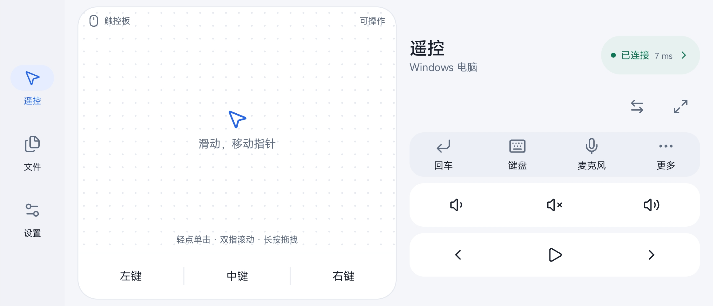
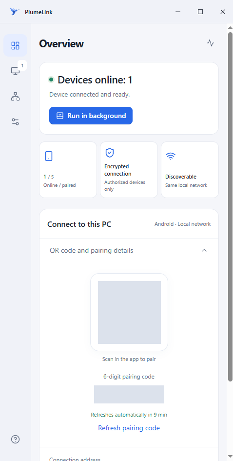

# PlumeLink

[简体中文](README.md)

Use an Android phone as a touchpad, directional remote or microphone for a Windows PC. You can also send files in either direction. Connect directly over your local network or a USB data cable. No account is required.

PlumeLink provides a Windows desktop app and a native Android client. There is no standalone web client.

[View all screenshots](docs/INTERFACE.md) · [Build from source](CONTRIBUTING.md#build-en)

## Installation

Install the APK on your phone and run the Windows installer with VB-CABLE on your PC. Download public builds from [GitHub Releases](https://github.com/kuiwaiwai/plumelink/releases).

| File | When to use it |
| --- | --- |
| Android APK | Install on your phone and pair it with the Windows app |
| Windows installer with driver (`-setup-with-vb-cable.exe`) | Includes VB-CABLE for routing the phone microphone into a Windows app |

The Windows installer downloads WebView2 if needed. The touchpad, directional remote and file transfers work independently of the audio driver.

## Control the PC

- **Touchpad.** Move the pointer, tap to click, hold to drag, scroll with two fingers or pinch to zoom. In the two-pane landscape layout, place the touchpad on either side.
- **Directional remote.** Use the D-pad, confirm and cancel buttons to navigate menus or a media player. Choose the remote mode and dial size in the phone’s touch and feedback settings. In landscape, use the opposing arrows to swap sides and the diagonal arrows to toggle focus mode.
- **Keyboard and shortcuts.** Send text to the focused field on the PC, pick a window, or control playback and volume. Choose an action and icon for each of the three shortcut slots, configure letters, digits, F1–F12 and combinations with Ctrl, Alt, Shift or Win, or use an editing, browsing, presentation or system media preset. System media controls work with players that support Windows media keys.

Preview and switch the three shortcut slots under More → Shortcut plans. Save your current actions and icons in up to eight custom plans for each PC.
- **Quick launch.** Add .exe apps or folders under Preferences → Remote control settings → PC shortcuts and choose their display names. Assign Quick launch to a phone shortcut slot to open them. Folders open in File Explorer on the PC.

The interface supports English, Simplified Chinese and Traditional Chinese, with light, dark and system appearance settings.

PlumeLink uses the open-source [QFastTransmission 0.2.0](https://github.com/kuiwaiwai/plumelink/tree/main/QFastTransmission) kernel to improve the **consistency**, **reliability**, and **stability** of remote input.

## Pair your phone

The desktop app targets Windows 10/11 x64 and uses WebView2. The phone needs Android 8.0 or later with a WebView provider (Android System WebView or Chrome) at version 85 or later.

1. Connect the phone to Wi-Fi. Connect the PC to the same trusted local network over Wi-Fi or Ethernet.
2. Open PlumeLink on the PC to see the pairing QR code and six-digit code.
3. Scan the QR code in the Android app or pick the PC from the nearby devices list. Check the certificate fingerprint on first connection and follow the pairing prompt. If discovery is unavailable, enter the address and port manually. The default port is `17840`.

The phone remembers paired PCs. Manage each phone’s permissions or revoke access in the device list on Windows. [Connection troubleshooting](docs/TROUBLESHOOTING.md)

### USB connection

The Windows installer includes the USB connection component; Android Platform-Tools does not need to be installed separately. Enable USB debugging in the phone’s developer options, connect a data cable and approve this PC on the phone.

In PlumeLink on Windows, open Preferences → USB connection, check for devices and connect the selected phone. On first use, compare the certificate and address with the PC’s USB panel and enter the pairing code shown there. USB tethering is not required.

Remote control, text, window selection, files and microphone audio use the same encrypted connection and device permissions. The PC keeps separate USB and wireless addresses while sharing its paired phone’s shortcut configuration.

Reconnecting the cable restores the USB channel for phones selected during the current PC session. Disconnecting a phone in PlumeLink cancels its automatic recovery. After exiting or restarting PlumeLink on the PC, select the phone again; its pairing is retained.

Each phone has its own USB endpoint, shown below its name. Disconnecting one phone stops its wired sessions while other phones and wireless connections remain available.

## Files and microphone

To send a file to the phone, drop it in the file-sharing area on Windows, then open **Files** on the phone and save it. To send files to the PC, choose them in PlumeLink or use **Share → PlumeLink** in a gallery or file manager, then review the pending list and target PC before sending. Each device has its own receive folder. The limit is 2 GB per file.

To listen to the phone through the PC, select a playback device in the desktop microphone settings. To use the phone as an input in a website or recording app, route it through a virtual audio cable. With VB-CABLE, send audio to `CABLE Input` in PlumeLink and select `CABLE Output` as the microphone in the receiving app. [Microphone and file transfer guide](docs/REMOTE-AUDIO-TRANSFERS.md)

## Project documentation

[Devices and permissions](docs/SECURITY.md) · [Privacy policy](PRIVACY.md)

Bug reports and contributions are welcome. [GitHub Issues](https://github.com/kuiwaiwai/plumelink/issues) · [Contributing](CONTRIBUTING.md)

PlumeLink uses the MIT license. Third-party components and the optional audio driver have their own terms. [License](LICENSE) · [Third-party notices](THIRD_PARTY_NOTICES.md)
