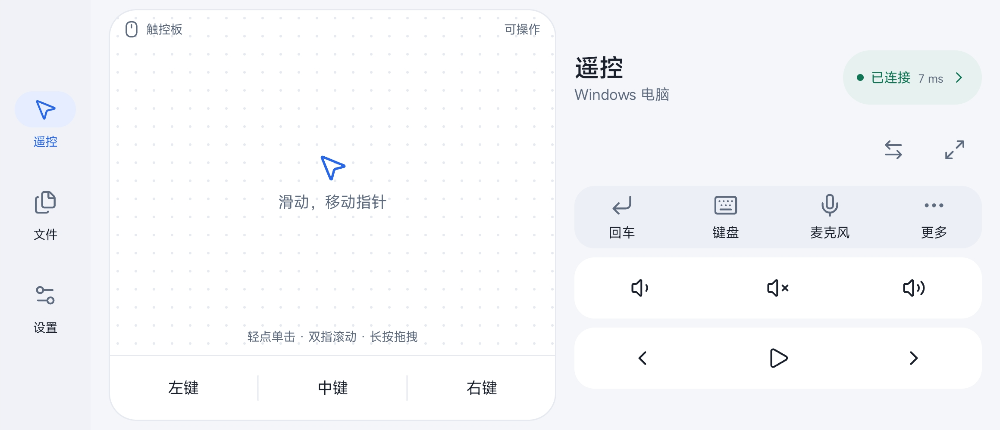
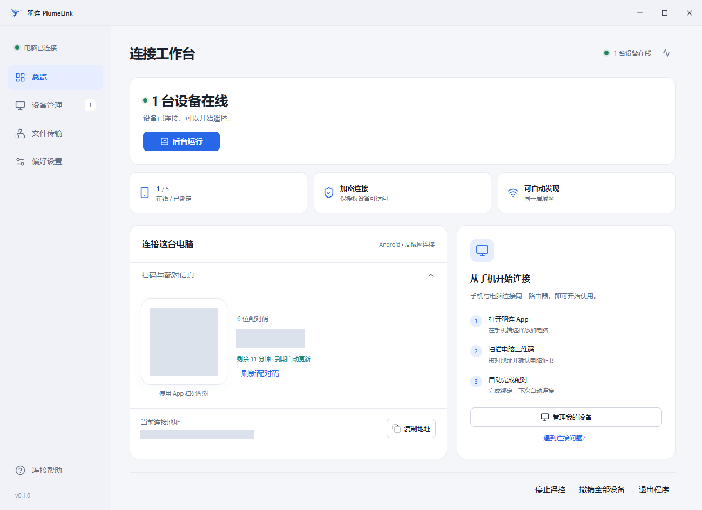

# 羽连 PlumeLink

[English](README.en.md)

羽连把 Android 手机变成 Windows 电脑的触控板、方向遥控器和麦克风，也可以在两端互传文件。手机和电脑通过局域网或 USB 数据线直接连接，无需注册账号。

提供 Windows 桌面端和 Android 原生客户端，不提供独立网页客户端。

[看全部界面截图](docs/INTERFACE.md) · [从源码运行](CONTRIBUTING.md#build-zh)

## 安装

手机安装 APK，电脑运行带 VB-CABLE 的 Windows 安装程序。公开版本可从 [GitHub Releases](https://github.com/kuiwaiwai/plumelink/releases) 下载。

| 文件 | 适合的用法 |
| --- | --- |
| Android APK | 安装到 Android 手机上，与电脑端配对 |
| Windows 带驱动安装版（`-setup-with-vb-cable.exe`） | 附带 VB-CABLE 驱动包，方便将手机麦克风用作电脑软件的输入 |

Windows 安装程序会在缺少 WebView2 时联网下载运行时。触控板、方向遥控和文件互传都可以独立使用。

## 遥控电脑

- **触控板**支持移动、点击、长按拖拽、双指滚动和捏合缩放。横屏双栏时可把触控区放在左侧或右侧。
- **方向遥控**提供十字方向键、确认和取消，适合在电脑菜单或播放器里移动焦点。在手机「设置 → 触控与反馈」中选择操控形式和方向盘大小。横屏时点击双向箭头可以换边，对角箭头可以切换专注模式。
- **键盘与快捷操作**可以向电脑当前输入框发送文字、选择窗口或控制播放和音量。三个快捷位可选择操作和图标，或设置字母、数字、F1–F12 等按键与 Ctrl、Alt、Shift、Win 的组合，也可以选择编辑、浏览、演示和媒体控制等预设。系统媒体控制适用于支持 Windows 媒体按键的播放器。
- **快捷启动**可从手机打开电脑上配置的应用或文件夹。在电脑「偏好设置 → 遥控设置 → 电脑快捷入口」中添加 .exe 应用或文件夹，可修改显示名称；手机快捷位选择「快捷启动」后即可使用。文件夹会在电脑的文件资源管理器中打开。

在「更多 → 快捷方案」预览和切换三个快捷位；也可保存当前操作及图标，每台电脑最多八个自建方案。

界面支持简体中文、繁體中文和 English，可跟随系统切换浅色或深色外观。

羽连使用开源传输内核 [QFastTransmission 0.2.0](https://github.com/kuiwaiwai/plumelink/tree/main/QFastTransmission)，提升遥控输入的**一致性**、**可靠性**和**稳定性**。

## 第一次配对

电脑端面向 Windows 10/11 x64，使用 WebView2。手机端需要 Android 8.0 或以上版本，系统 WebView 或作为其提供方的 Chrome 需要达到 85 或以上版本。

1. 手机连上 Wi-Fi，电脑通过 Wi-Fi 或网线接入同一可信局域网。
2. 打开电脑端，在「连接工作台」查看二维码和 6 位配对码。
3. 在手机端扫码，或从附近电脑中选中这台电脑。首次连接时核对证书指纹，按提示完成配对。找不到电脑时可以手动输入地址和端口，默认端口为 `17840`。

配对后，手机会记住电脑。你可以在 Windows 的「设备管理」中查看已配对的手机、调整各自的权限或撤销访问。[连接遇到问题](docs/TROUBLESHOOTING.md)

### 通过 USB 连接

电脑安装版已内置 USB 连接组件，无需另行安装 Android Platform-Tools。在手机开发者选项中开启 USB 调试，用数据线连接电脑，并在手机上允许这台电脑调试。

打开电脑羽连「偏好设置 → USB 有线连接」，点击「重新检测」并选择手机连接。首次连接，在手机上核对电脑证书并输入此区域显示的配对码；后续连接沿用已有配对。无需开启 USB 网络共享。

遥控、文字、窗口、文件和麦克风都使用同一条加密链路；设备权限仍在「设备管理」中配置。有线与无线使用同一台电脑的快捷配置，并分别保留连接地址。

重新插接数据线后，电脑端会恢复本次已选择手机的 USB 通道；点击「断开」会取消该手机的自动恢复。退出或重启电脑羽连后，需要重新选择手机，无需重新配对。

多台手机使用各自的 USB 入口，可在对应手机下方查看地址。单独断开一台手机会停止它的有线会话，其它手机和无线连接可继续使用。

## 文件和麦克风

要把文件发到手机，将文件拖到电脑端的文件共享区域，再到手机的「文件」页选取并保存。要发给电脑，可在手机端选择文件，或从相册、文件管理器选择「分享 → 羽连」，核对待发送列表和目标电脑后发送。两端均可指定接收目录，单文件上限为 2 GB。

要在电脑上听到手机收音，在「手机麦克风」里选择播放设备。要在网站或收音软件中使用手机麦克风，需要一条虚拟音频线路。以 VB-CABLE 为例，羽连把声音送往 `CABLE Input`，网站或软件选择 `CABLE Output` 作为麦克风。[麦克风与文件传输指南](docs/REMOTE-AUDIO-TRANSFERS.md)

## 项目文档

[设备与权限](docs/SECURITY.md) · [隐私政策](PRIVACY.md)

欢迎反馈使用问题或参与开发。[GitHub Issues](https://github.com/kuiwaiwai/plumelink/issues) · [贡献指南](CONTRIBUTING.md)

羽连采用 MIT 许可证。第三方组件及可选音频驱动的许可单独列出。[许可证](LICENSE) · [第三方声明](THIRD_PARTY_NOTICES.md)

## 友情链接

[LINUX DO](https://linux.do/)
