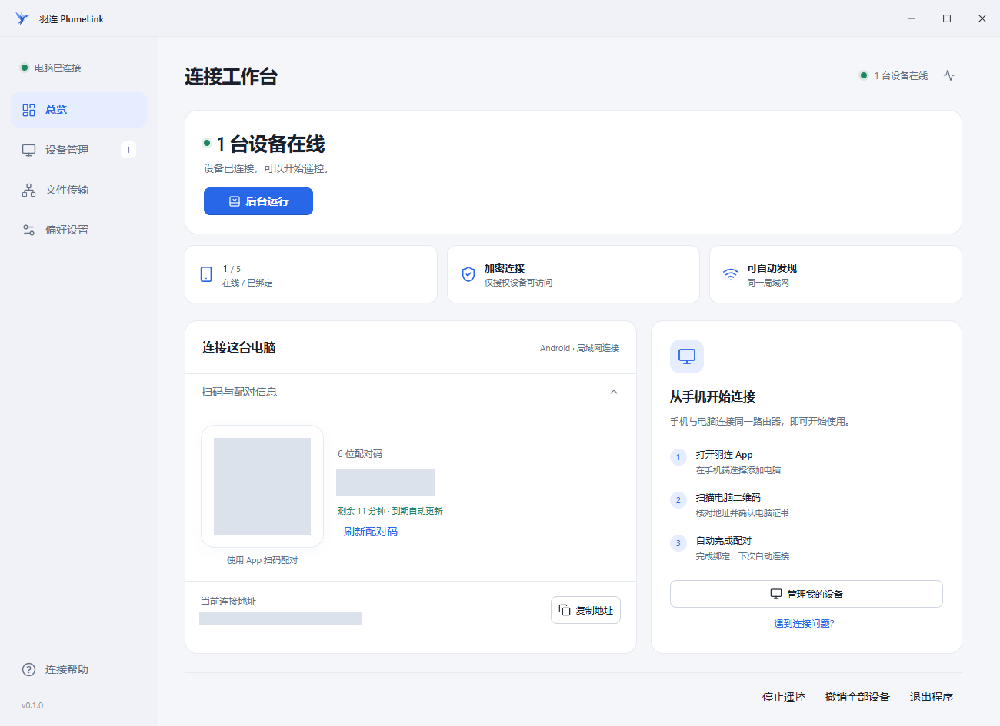
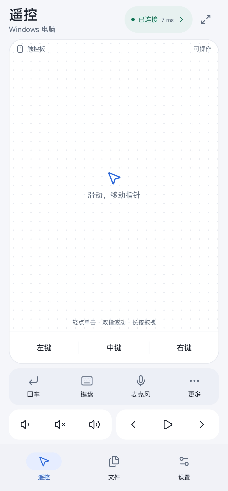
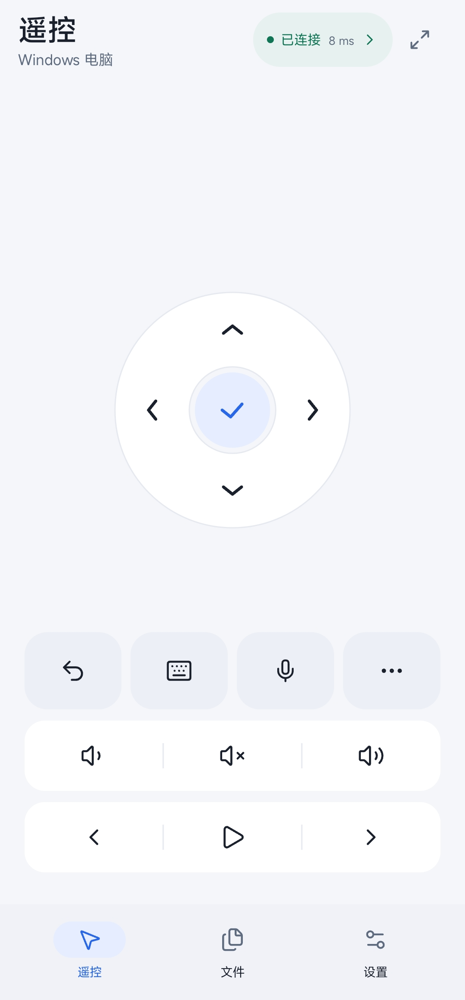
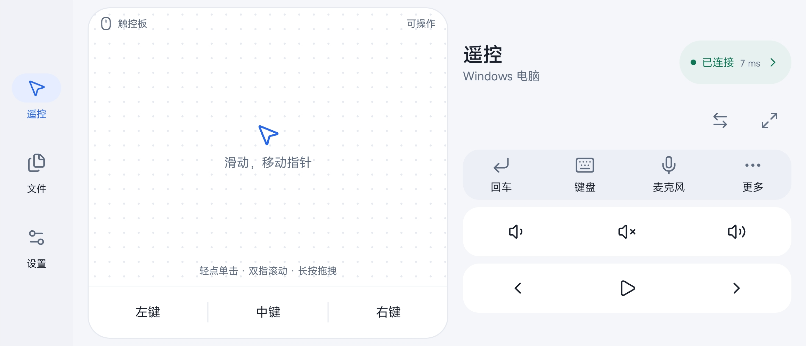

# 羽连 PlumeLink

[English](README.md) · 简体中文

把 Android 手机变成 Windows 电脑的触控板、方向遥控器或麦克风，也可以在两端互传文件。通过局域网或 USB 数据线直接连接，无需注册账号。

[下载](https://github.com/kuiwaiwai/plumelink/releases) · [使用指南](docs/INTERFACE.md) · [连接遇到问题](docs/TROUBLESHOOTING.md)

## 界面一览

<table>
  <tr>
    <td colspan="2" align="center"> Windows 连接工作台</td>
  </tr>
  <tr>
    <td width="50%" align="center"> 触控板</td>
    <td width="50%" align="center"> 方向遥控</td>
  </tr>
  <tr>
    <td colspan="2" align="center"> 横屏触控板</td>
  </tr>
</table>

## 适合这些时候

- **电脑在书房，连接的显示器或电视在客厅，操作太麻烦？** 手机就在手边，坐在沙发上也能移动指针、选择内容和控制播放。
- **人已经躺在床上，不想离开温暖的被窝？** 调音量、暂停视频、给电脑输入文字，都可以直接用手机完成。
- **有旧手机想充分利用？** 放在床头或沙发旁，当作专用遥控器。使用前请确认符合下方的 Android 和 WebView 要求。

## 安装

从 [GitHub Releases](https://github.com/kuiwaiwai/plumelink/releases) 下载两个安装包。

| 设备 | 安装包 | 系统要求 |
| --- | --- | --- |
| 手机 | Android APK | Android 8.0 或以上；系统 WebView 或作为其提供方的 Chrome 版本为 85 或以上 |
| 电脑 | Windows 带 VB-CABLE 安装版（`-setup-with-vb-cable.exe`） | Windows 10/11 x64、Microsoft Edge WebView2 |

手机安装 APK，电脑运行安装程序。电脑缺少 WebView2 时，安装程序会联网下载。VB-CABLE 用于将手机收音送入网站或收音软件；遥控和文件互传无需配置音频驱动。

## 连接手机

### 局域网

1. 手机和电脑连接同一可信局域网，电脑可以使用 Wi-Fi 或网线。
2. 打开电脑端羽连，查看二维码和六位配对码。
3. 在 Android 端扫码、选择附近电脑，或手动输入地址。核对证书指纹后完成配对。默认服务端口为 `17840`。

手机会记住配对过的电脑。在 Windows「设备管理」中可以调整各台手机的权限或撤销访问。请妥善保管配对码，并在可信网络中使用。[设备与权限](docs/SECURITY.md)

### USB 数据线

1. 在手机开发者选项中开启 USB 调试，连接数据线，并在手机上允许这台电脑调试。
2. 在电脑端打开「偏好设置 → USB 有线连接」，检测并连接手机。安装版已内置 USB 组件。
3. 首次使用时，与电脑 USB 区域核对地址和证书，再输入该区域显示的配对码。

遥控、文字、窗口切换、文件和麦克风均可通过 USB 使用，沿用相同的设备权限，无需开启 USB 网络共享。重新插接数据线可恢复本次电脑程序运行期间已选择的手机；重启电脑端羽连后，需要重新选择手机，已有配对会保留。

## 遥控电脑

| 功能 | 可以做什么 |
| --- | --- |
| 触控板 | 移动指针、轻点点击、长按拖拽、双指滚动和捏合缩放 |
| 方向遥控 | 十字方向键、确认和取消；按住方向键可连续移动，方向盘大小可在设置中调整 |
| 键盘与窗口 | 向电脑当前输入框发送文字，查找并切换窗口 |
| 快捷操作与媒体 | 自定义三个快捷位的操作、图标和组合键，或选择编辑、浏览、演示、媒体等预设 |
| 快捷启动 | 打开电脑「偏好设置 → 遥控设置 → 电脑快捷入口」中配置的应用或文件夹 |

横屏可交换两侧操作区，也可开启专注模式腾出更多空间。每台电脑可保存八个自建快捷方案，在「更多 → 快捷方案」中切换。系统媒体操作适用于支持 Windows 媒体按键的播放器。

两端均支持简体中文、繁體中文和 English，外观可选择浅色、深色或跟随系统。

羽连使用开源内核 [QFastTransmission 0.2.0](https://github.com/kuiwaiwai/plumelink/tree/main/QFastTransmission)，提升**一致性**、**可靠性**和**稳定性**。

## 文件和麦克风

**文件：** 在电脑文件页添加共享文件，再到手机「文件」页保存。要发给电脑，可在羽连中选择文件，或从其它 Android 应用选择「分享 → 羽连」，核对文件列表和目标电脑后发送。两端分别选择接收目录，单文件上限为 2 GB。

**麦克风：** 在电脑「偏好设置 → 手机麦克风」中配置声音去向。要在网站或收音软件中使用，羽连选择 `CABLE Input`，网站或软件选择 `CABLE Output` 作为麦克风。按住手机麦克风按钮说话，上滑停留一秒后可松手持续收音，点击停止按钮结束。

[麦克风与文件互传指南](docs/REMOTE-AUDIO-TRANSFERS.md)

## 文档与贡献

[使用指南](docs/INTERFACE.md) · [连接遇到问题](docs/TROUBLESHOOTING.md) · [设备与权限](docs/SECURITY.md) · [隐私政策](PRIVACY.md)

欢迎通过 [GitHub Issues](https://github.com/kuiwaiwai/plumelink/issues) 反馈问题，或提交 Pull Request 参与改进。构建环境和命令见[贡献指南](CONTRIBUTING.md)。

羽连采用 [MIT 许可证](LICENSE)。第三方组件与音频驱动适用各自的条款：[第三方声明](THIRD_PARTY_NOTICES.md)。

## 友情链接

[LINUX DO](https://linux.do/)
