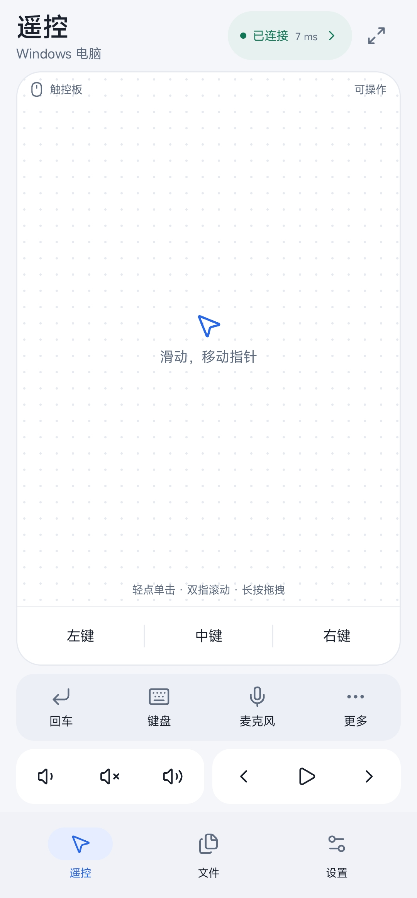
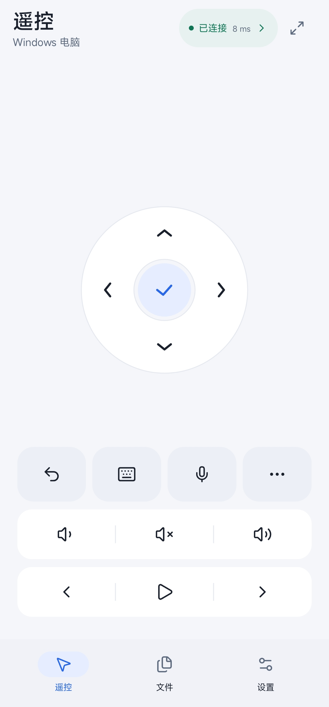
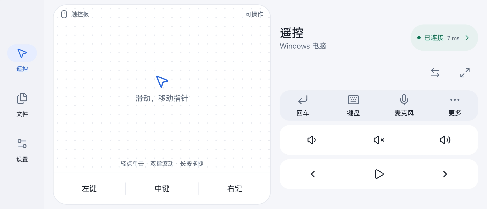
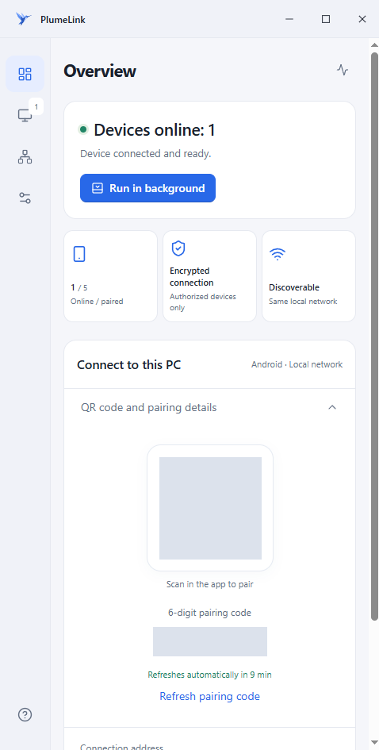
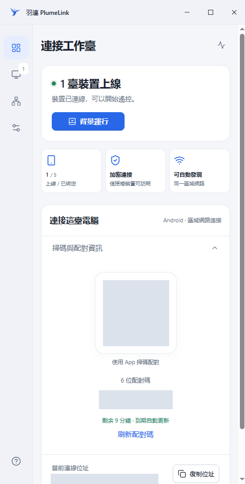

# User guide

[Overview](../README.md) · [简体中文首页](../README.zh-CN.md) · [Troubleshooting](TROUBLESHOOTING.md)

## Interface

<table>
  <tr>
    <td colspan="2" align="center"> Windows overview</td>
  </tr>
  <tr>
    <td width="50%" align="center"> Touchpad</td>
    <td width="50%" align="center"> Directional remote</td>
  </tr>
  <tr>
    <td colspan="2" align="center"> Landscape touchpad</td>
  </tr>
</table>

## Android

### Remote controls

Choose the touchpad or directional remote under **Settings → Touch and feedback**. Adjust the dial size to suit your hand. Hold a direction to repeat; release it or slide outside the button to stop. The confirm button runs once per press.

In landscape, use the opposing arrows to swap sides and the diagonal arrows to hide or show navigation. Focus mode gives the controls more room.

**Volume keys control PC** is off by default. Enable it to adjust PC volume with the phone’s physical keys while on the connected Remote page with remote-control permission. Opening a menu, changing pages or leaving the app stops repetition.

### Shortcuts and plans

Choose an action and icon for each of the three shortcut slots. You can use a preset or assign keys and combinations with Ctrl, Alt, Shift or Win.

Save the current three actions and icons under **Settings → Shortcuts → Shortcut plans**, or switch plans under **More → Shortcut plans**. Preview the keys before applying a plan. Each PC can have eight saved plans. Applying a plan does not execute its keys, and deleting one keeps your current shortcuts.

For PowerPoint, choose the presentation preset to use previous page, black screen and next page from More. Keep the slide show in front. Tap black screen again to restore the picture; use Esc to leave the show. Start slideshow and From this slide can be assigned separately.

### Windows and quick launch

Open **More → Switch windows** to choose a PC window. Tap Search to filter by title or app name; separate keywords with spaces. Clear the search to show all windows, or press Back to collapse the search bar.

On Windows, add apps or folders under **Preferences → Remote control settings → PC shortcuts**. Assign **Quick launch** to a phone shortcut to access them. Search by name at the top of the sheet. You can close the sheet while an app opens; check the PC to see whether its window is in front.

### Connection and background use

The connection page adapts to portrait and landscape. Rotating the phone preserves a draft PC name, location or address.

**Keep app running** is on by default. A native foreground service maintains the connection when the screen is off. Returning to the app starts a fresh input session; earlier keys and drags are not replayed. **Background settings** opens the system controls for battery restrictions. See [Background connection help](TROUBLESHOOTING.md#connection-stops-in-the-background).

Use **Files** to send or save files and the microphone button to talk. For receive folders, continuous recording and audio routing, see [Microphone and file transfers](REMOTE-AUDIO-TRANSFERS.md).

| Landscape directional remote |
| --- |
|  |

## Windows

The overview shows pairing details and connection status. Use **Devices** to manage permissions, **Files** to share and receive files, and **Preferences** to change the language, theme, service port and pairing-code interval.

Pairing credentials, network addresses and personal device and directory information are masked in the screenshots.

<table>
  <tr>
    <th>Devices</th>
    <th>File transfers</th>
  </tr>
  <tr>
    <td width="50%"></td>
    <td width="50%"></td>
  </tr>
  <tr>
    <td colspan="2" align="center"> Preferences</td>
  </tr>
</table>

## Languages

Both apps support English, Simplified Chinese and Traditional Chinese.

| English | 简体中文 | 繁體中文 |
| --- | --- | --- |
|  |  |  |
