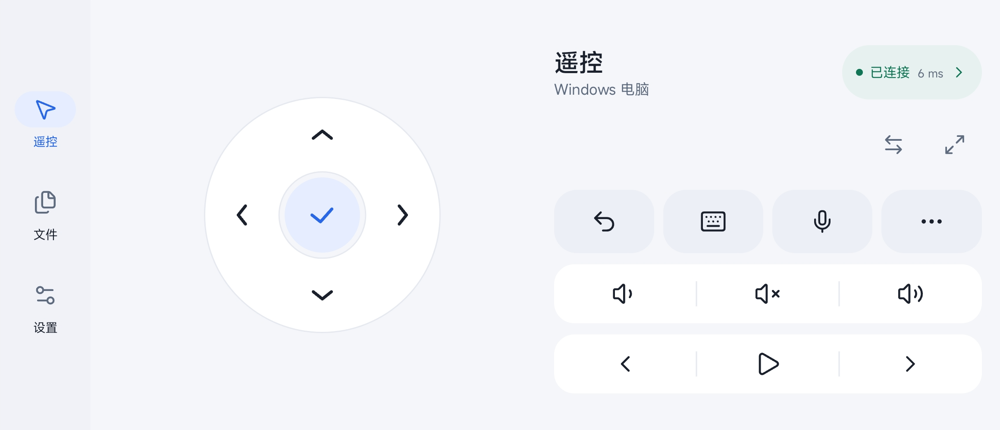
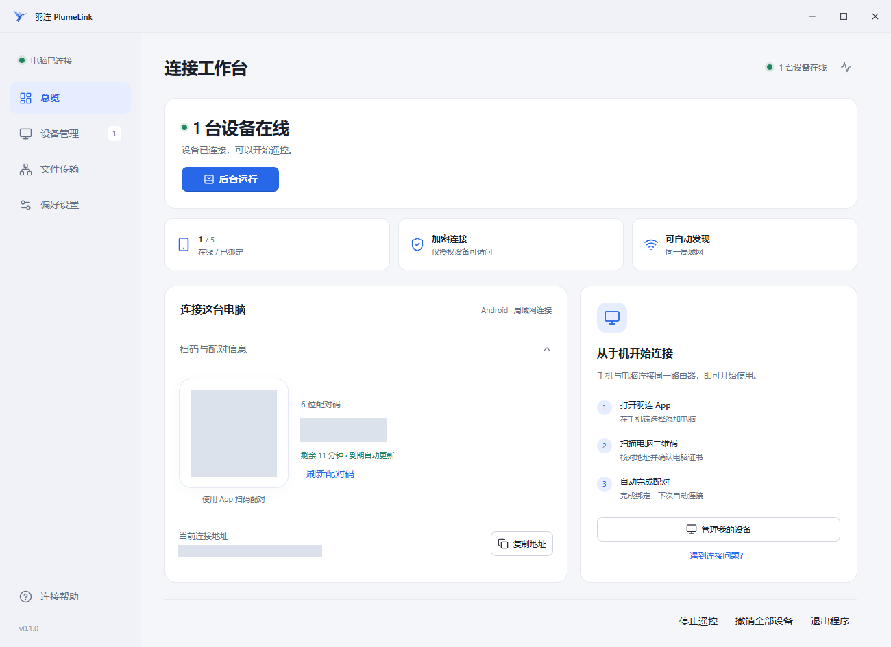
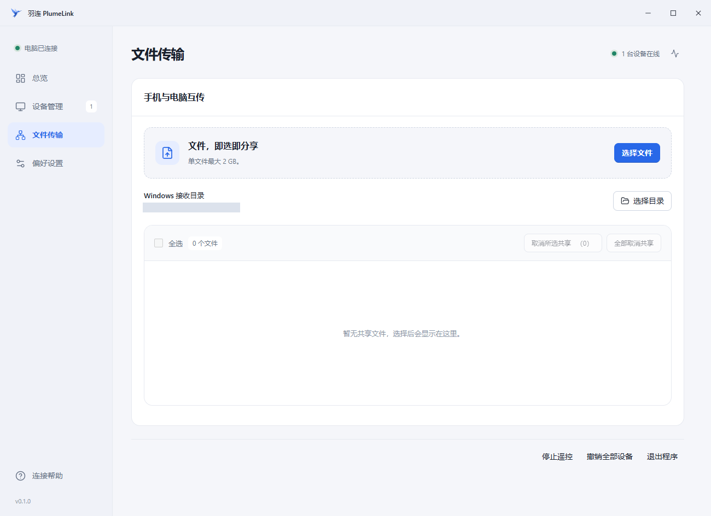
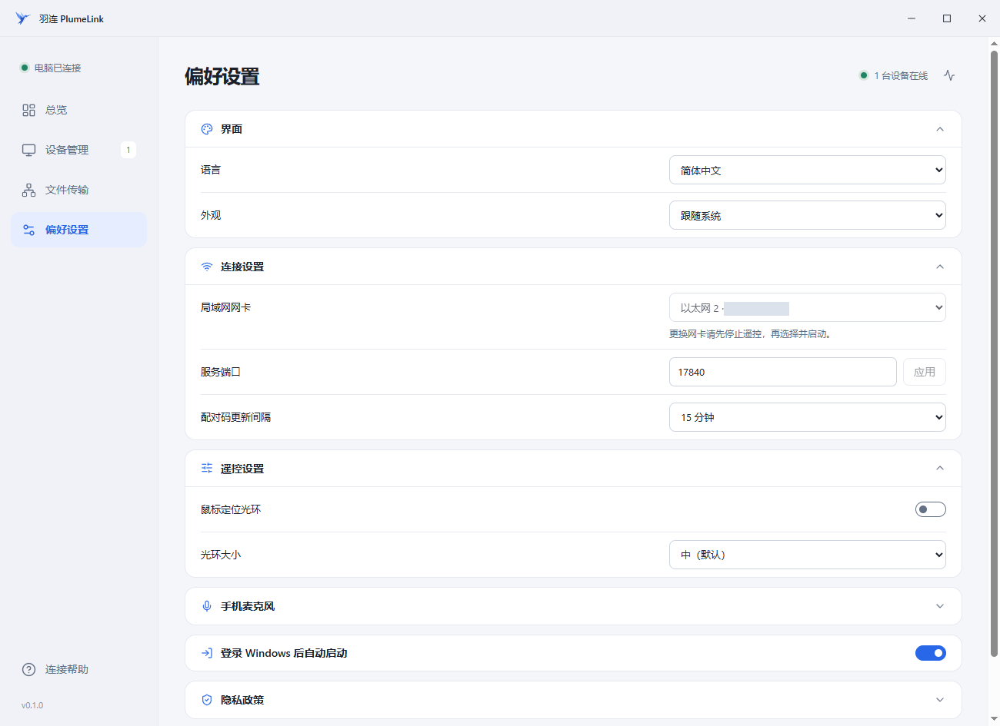

# 羽连界面 · PlumeLink in use

[中文首页](../README.md) · [English overview](../README.en.md)

## Android

连接页会根据可用空间安排电脑列表和连接操作：竖屏操作位于底部，宽横屏放在侧边，较窄的短窗口可滚动查看。编辑电脑名称、位置或连接地址时，旋转屏幕会保留正在输入的内容。

The connection page adapts to the available space: connection actions sit below the PC list in portrait, beside it in wide landscape, or within the scrollable page in a narrow, short window. Rotating the screen preserves your draft when editing a PC name, location or address.

在「设置 → 触控与反馈」选择触控板或方向遥控。横屏时，双向箭头让两侧互换，对角箭头隐藏或显示导航。

在「设置 → 快捷操作 → 快捷方案」保存当前三个快捷操作和图标，也可从「更多 → 快捷方案」切换。选择方案后先查看三键预览，再点击「应用方案」。每台电脑可保存八个自建方案，支持重命名和删除；删除不改变正在使用的按键，切换方案不会自动执行按键。

方向键支持按住连续移动，松手或移出按键区域即停止。确认键只执行一次。

「音量键控制电脑」默认关闭。开启后，仅在已连接并拥有遥控权限的遥控页中，用手机音量键调节电脑音量，按住可连续调节。打开菜单、切换页面或离开应用会停止连发。

「应用保活」默认开启，连接电脑后通过原生前台服务维护息屏时的连接。返回应用会建立新的输入会话，离开前的按键和拖拽不会继续执行。「后台运行设置」可用于解除系统电池限制。

Keep connection alive is enabled by default. A native foreground service maintains the connection when the screen is off. Returning to the app starts a fresh input session without replaying earlier keys or drags. Background settings opens the system controls for battery restrictions.

在电脑的「偏好设置 → 遥控设置 → 电脑快捷入口」中添加应用或文件夹，再把手机的快捷操作设为「快捷启动」。入口较多时，可在抽屉顶部按名称搜索；清除搜索即可查看全部入口。显示「正在打开」时，可以关闭抽屉继续遥控；启动结果会单独确认，应用是否已切到前台以电脑画面为准。

Choose the touchpad or D-pad in the phone’s touch and feedback settings. In landscape, the opposing arrows swap the controls between hands. The diagonal arrows hide or show navigation.

Save your three shortcuts and icons under Settings → Shortcuts → Shortcut plans, or switch from More → Shortcut plans. Preview the three keys, then tap Apply plan. Each PC can have eight saved plans with rename and delete controls. Deleting a plan keeps your current keys; applying a plan does not run them.

Hold a direction to move repeatedly. Release or move outside its button area to stop. Confirm runs once.

Volume keys control PC is off by default. Enable it to adjust PC volume with the phone’s volume keys on the connected Remote page while remote control is allowed. Hold to repeat; opening a menu, changing pages or leaving the app stops repetition.

Add apps or folders under Preferences → Remote control settings → PC shortcuts on Windows, then assign Quick launch to a phone shortcut. For larger lists, search by name at the top of the sheet. Clear the search to see all entries. While Opening is shown, you can close the sheet and continue using the remote. Launch results are confirmed separately; check the PC to see whether its window is in front.

在「更多 → 切换窗口」中点击搜索图标，可按窗口标题或应用名查找，多个关键词用空格分隔。清除搜索可恢复完整列表；返回键可收起搜索栏。

In More → Switch windows, tap Search to filter by window title or app name. Separate keywords with spaces. Clear the search to see every window, or press Back to collapse the search bar.

在手机设置中选择「演示放映」快捷预设，即可在「更多」中使用上一页、黑屏切换和下一页。先让 Windows PowerPoint 放映窗口处于前台；黑屏切换再点一次会恢复画面。「开始放映」和「当前页放映」可单独添加到快捷操作，退出放映使用已有的 Esc。已有快捷配置不会自动替换，选择预设后才会应用。

Choose the Presentations shortcut preset in phone Settings to use Previous page, Black screen and Next page under More. Keep the Windows PowerPoint slide show in front; tap Black screen again to restore it. Start slideshow and From this slide can be assigned separately. Use the existing Esc action to exit. Existing shortcut configurations stay as saved until you choose a preset.

[PowerPoint 按键说明 · Keyboard reference](https://support.microsoft.com/en-us/accessibility/powerpoint/use-a-screen-reader-to-show-your-presentation-with-powerpoint)

| 触控板 · Touchpad | 方向遥控 · D-pad |
| --- | --- |
|  |  |

**横屏触控板 · Landscape touchpad**

**横屏方向遥控 · Landscape D-pad**

手机可通过系统「分享 → 羽连」添加待发送文件，核对列表和目标电脑后发送。已有传输中的新分享会保留，待当前任务结束后再确认发送。

On Android, use **Share → PlumeLink** to prepare files, then review the list and target PC before sending. Files shared during a transfer remain pending for your next confirmation.

## Windows

在连接工作台查看配对信息和在线状态。下图中配对二维码、配对码、局域网地址以及其他截图中的设备和目录信息均已遮盖。

The overview shows pairing details and connected devices. Pairing credentials, network addresses, device details and personal paths are masked in these screenshots.

| 设备管理 · Devices | 文件传输 · File transfers |
| --- | --- |
|  |  |

**偏好设置 · Preferences**

在这里调整语言、外观、服务端口和配对码更新间隔。Open Preferences to change the language, appearance, service port or pairing code interval.

**界面语言 · Interface languages**

| 简体中文 | 繁體中文 | English |
| --- | --- | --- |
|  |  |  |
