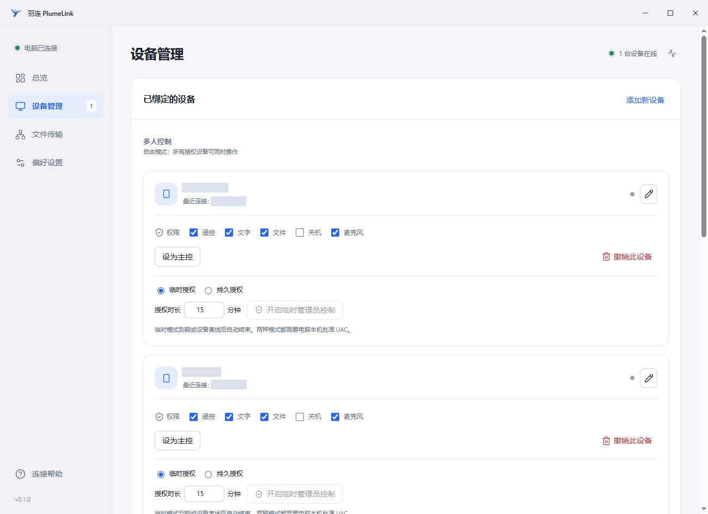
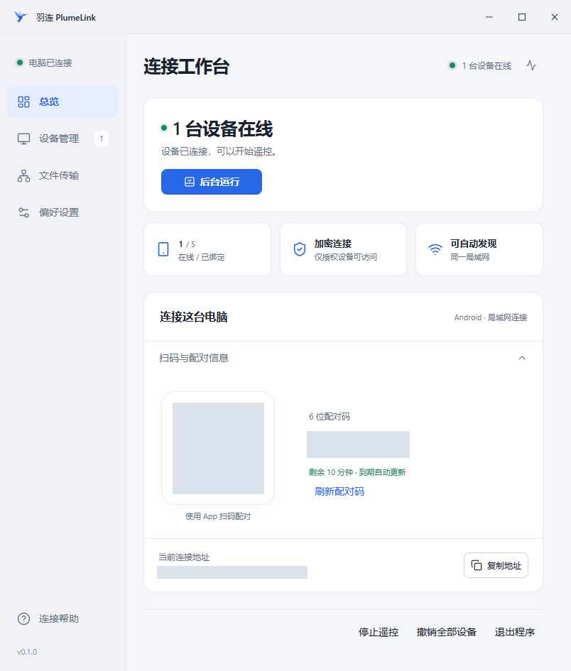

# 羽连界面 · PlumeLink in use

[中文首页](../README.md) · [English overview](../README.en.md)

## Android

在「设置 → 触控与反馈」选择触控板或方向遥控。横屏时，双向箭头让两侧互换，对角箭头隐藏或显示导航。

Choose the touchpad or D-pad in the phone’s touch and feedback settings. In landscape, the opposing arrows swap the controls between hands. The diagonal arrows hide or show navigation.

| 触控板 · Touchpad | 方向遥控 · D-pad |
| --- | --- |
|  |  |

**横屏触控板 · Landscape touchpad**

**横屏方向遥控 · Landscape D-pad**

## Windows

在连接工作台查看配对信息和在线状态。下图中配对二维码、配对码、局域网地址以及其他截图中的设备和目录信息均已遮盖。

The overview shows pairing details and connected devices. Pairing credentials, network addresses, device details and personal paths are masked in these screenshots.

| 设备管理 · Devices | 文件传输 · File transfers |
| --- | --- |
|  |  |

**偏好设置 · Preferences**

在这里调整语言、外观、服务端口和配对码更新间隔。Open Preferences to change the language, appearance, service port or pairing code interval.

**界面语言 · Interface languages**

| 简体中文 | 繁體中文 | English |
| --- | --- | --- |
|  |  |  |
